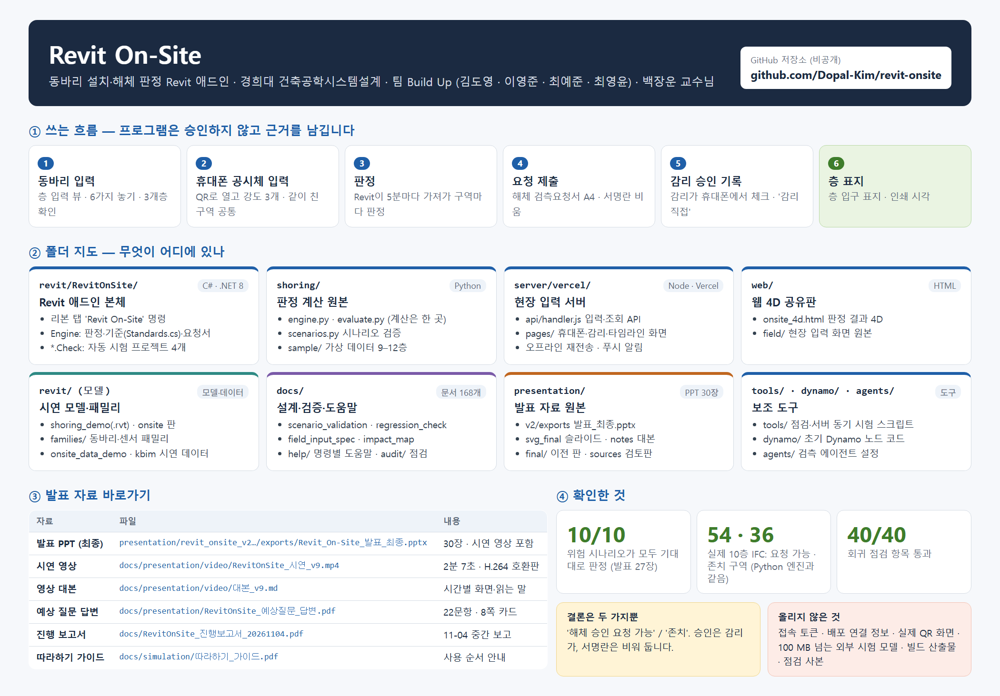

# Revit On-Site

동바리 설치·해체 판정을 돕는 Revit 애드인입니다. 경희대 건축공학시스템설계, 팀 Build Up(김도영 · 이영준 · 최예준 · 최영윤), 담당 백장운 교수님.

> 프로그램의 결론은 **'해체 승인 요청 가능'** 또는 **'존치'** 두 가지뿐입니다. 승인은 감리가 하고, 서명란은 비워 둡니다.

## 쓰는 흐름

| 순서 | 단계 | 하는 일 |
|---|---|---|
| 1 | 동바리 입력 | 층 입력 뷰에서 사양을 넣고 6가지 방법으로 놓은 뒤 3개층 확인 |
| 2 | 휴대폰 공시체 입력 | 품질관리자가 QR로 열어 공시체 강도 3개 입력 |
| 3 | 판정 | Revit이 5분마다 입력을 가져가 구역마다 판정 |
| 4 | 요청 제출 | 해체 검측요청서 A4 출력 (서명란 비움) |
| 5 | 감리 승인 기록 | 감리가 휴대폰에서 확인하고 '감리 직접'으로 기록 |
| 6 | 층 표지 | 층 입구 표지 출력 (인쇄 시각 표시) |

## 폴더 지도

| 경로 | 내용 |
|---|---|
| `revit/RevitOnSite/` | C# 애드인 본체 (Revit 2026, .NET 8). `RevitOnSite.Engine` 판정·기준·요청서, `*.Check` 자동 시험 |
| `shoring/` | 판정 계산 원본 (`engine.py`, `evaluate.py`), 시나리오 검증, 가상 데이터 |
| `server/vercel/` | 현장 입력 서버 (휴대폰·감리·타임라인 화면, API) |
| `web/` | 웹 4D 공유판, 현장 입력 화면 원본 |
| `revit/` | 시연 모델(`shoring_demo.rvt`, `shoring_demo_onsite.rvt`), 패밀리, 시연 데이터 |
| `docs/` | 설계·검증·도움말 문서, 발표 보조 자료 |
| `presentation/` | 발표 PPT 원본과 슬라이드 |
| `tools/`, `dynamo/`, `agents/` | 점검 스크립트, 초기 Dynamo 코드, 검측 에이전트 설정 |

## 발표 자료

| 자료 | 파일 |
|---|---|
| 발표 PPT (최종, 30장) | `presentation/revit_onsite_v2_ppt169_20261119/exports/Revit_On-Site_발표_최종.pptx` |
| 시연 영상 (2분 7초) | `docs/presentation/video/RevitOnSite_시연_v9.mp4` |
| 영상 대본 | `docs/presentation/video/대본_v9.md` |
| 예상 질문 답변 (22문항) | `docs/presentation/RevitOnSite_예상질문_답변.pdf` |
| 진행 보고서 (11-04) | `docs/RevitOnSite_진행보고서_20261104.pdf` |
| 따라하기 가이드 | `docs/simulation/따라하기_가이드.pdf` |

## 올리지 않은 것

접속 토큰, 배포 연결 정보, 실제 QR이 찍힌 화면, 100 MB가 넘는 외부 시험 모델(`revit/test_models/`), 빌드 산출물, 배포 zip, 점검용 사본. 목록은 `.gitignore`에 있습니다.
